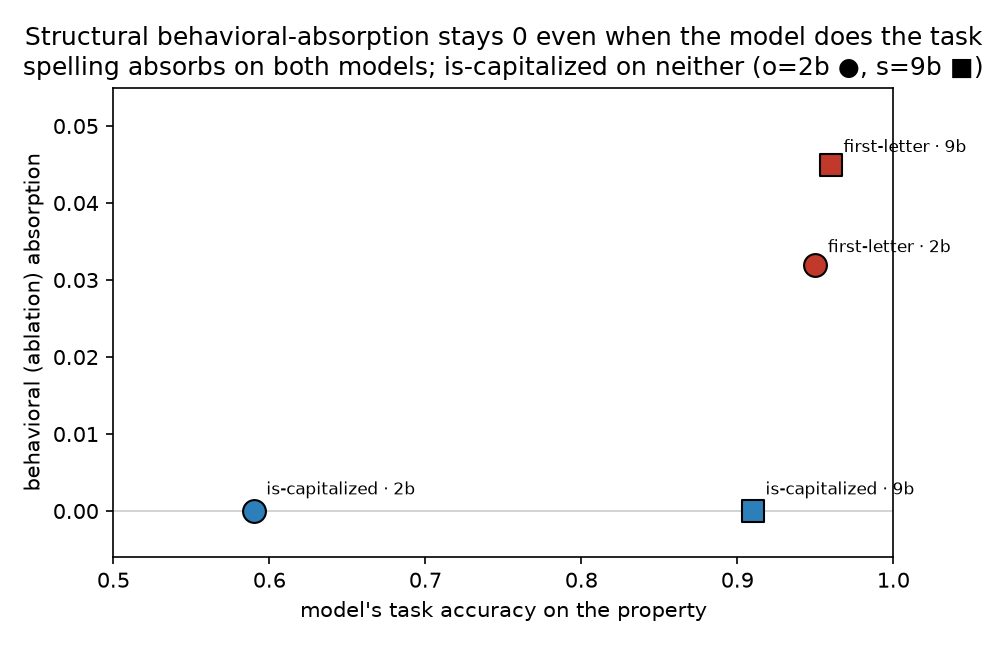
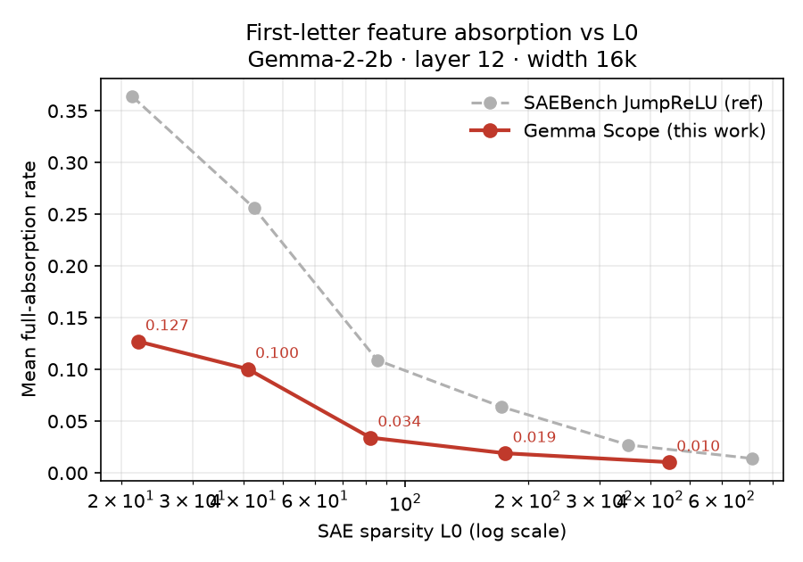
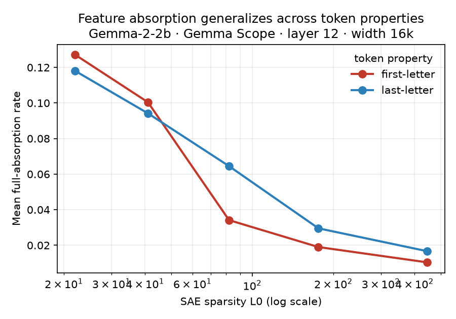

# Absorption Atlas

**How a concept is carried inside a network depends on what kind of concept it is.** With Gemma Scope
sparse autoencoders on Gemma-2-2B and 2-9B, letter-like properties are absorbed into token-specific
latents (first letter on both models, last letter on 2B), while the structural property
`is-capitalized` is almost never carried by a single causally responsible latent.

**Technical report** ([`paper/paper.pdf`](paper/paper.pdf)): the full 15-page write-up, a cross-metric,
cross-model study of feature absorption beyond first-letter spelling.

**Short version** ([`WRITEUP.md`](WRITEUP.md)): *Does the SAE-absorption metric over-report for
non-spelling features?*

## Headline result

On `is-capitalized`, the causal **ablation** metric finds almost no absorbed tokens: **1 of 198**
scored main-silent candidates on Gemma-2-2b (0.005, Wilson 95% CI [0.001, 0.028]; 727-candidate pool)
and **1 of 35** on Gemma-2-9b (0.029, [0.005, 0.145]; the other 238 of 273 candidates have an active main
latent), counting a token when one probe-aligned latent's attribution is at least 3× the runner-up's.
Under the same criterion first-letter gives 0.41 (2b) and 0.43 (9b). Chanin's original absolute IG-gap
threshold reports 0/200 and 0/35, but on the binary True/False logit the largest gap is 0.05 (2b) and
0.15 (9b), below the lowest threshold tested (0.5), so that zero is forced by scale. Cross-model and
matched-accuracy controls make task failure or a dead layer unlikely explanations. The
SAEBench-standard **projection** metric still reports single-latent absorption marginally above its
random-direction null (**0.12** vs 0.03 at n=130, with slightly overlapping Wilson intervals), so for a
distributed structural feature the two standard metrics disagree and the projection metric appears to
over-report.



*The figure plots the absolute-gap ablation rate per probe true positive; its `is-capitalized` zeros are
the scale-forced zeros described above, not the 1/198 and 1/35 counts.*

**Does SAE feature absorption generalize beyond first-letter spelling?**

Sparse autoencoders (SAEs) are meant to decompose a language model's activations into
reliable, monosemantic features. **Feature absorption** (Chanin et al.,
[2409.14507](https://arxiv.org/abs/2409.14507)) is a known failure mode: a specific latent
"absorbs" the direction of a more general one, so the general latent silently fails to fire.
For example, a *starts-with-L* latent stays dark on *lion* because a dedicated *lion* latent swallowed
the direction. This undermines the SAE-as-decomposition premise.

Today absorption is measured on essentially **one task**: "token starts with letter X". Whether
absorption is a **general** SAE failure mode or a **quirk of alphabetical spelling** is open.
This project measures absorption across a battery of other objective, tokenizer-derivable token
properties (last-letter, is-capitalized, ALL-CAPS, common suffixes) on off-the-shelf
public SAEs (Gemma Scope), to answer that question.

## Reproduction: first-letter absorption (pipeline validation)

Reproduced first-letter feature absorption on current Gemma Scope SAEs (Gemma-2-2b, layer 12,
width 16k), 200 prompts/letter, on GPU (2026-07-18). Rather than a single number, an **L0 sweep**
reproduces the paper's central law (absorption rises steeply as L0 falls) and sits a consistent
~2.6–3.4× *below* SAEBench's own JumpReLU reference, consistent with expectations for
Google's better-trained Gemma Scope SAEs:



| L0 | mean full-absorption |
|----|----------------------|
| 22 | 0.127 |
| 41 | 0.100 |
| 82 | 0.034 |
| 176 | 0.019 |
| 445 | 0.010 |

Per-letter variance is wide with `s` (Chanin's worked-example letter, *short*) among the highest.
Cross-checked against published SAEBench/Absorption results; see
[`results/gate/VERIFICATION.md`](results/gate/VERIFICATION.md).

**First generalization result: absorption is NOT specific to first-letter.** The same measurement on
**last-letter** (Gemma-2-2b, layer 12, 16k) gives a curve of the same shape and comparable (at mid/high
L0, *higher*) magnitude:



| L0 | first-letter | last-letter |
|----|--------------|-------------|
| 22  | 0.127 | 0.118 |
| 41  | 0.100 | 0.094 |
| 82  | 0.034 | 0.064 |
| 176 | 0.019 | 0.030 |
| 445 | 0.010 | 0.017 |

Last-letter is still a *letter* property (close to first-letter), so the two results reconcile:
**letter-family properties generalize** (last-letter absorbs like first-letter), while
**`is-capitalized` shows almost no behavioral absorption**, and that split is where the projection metric
parts ways with the causal one (see the [headline result](#headline-result) above). The full `is-capitalized`
study is in the [final report](paper/paper.pdf).

## Method (from Chanin et al. + their reference code)

For a concept, three stages (all from the [`sae-spelling`](https://github.com/lasr-spelling/sae-spelling) repo):

1. **LR probe** on the residual stream → the ground-truth concept direction.
2. **k-sparse probing** → the "main"/split SAE latents that predict the concept.
3. **IG-ablation absorption calculator** → on tokens where the probe fires but the main latents
   don't, integrated-gradient attribution confirms a single, probe-aligned latent causally
   carries the concept. `absorption_rate = #absorbed / #probe-true-positives`, per concept.

Extending to a new property needs its own ICL formatter + logit-diff `metric_fn` + probe +
k-sparse results; the calculator and aggregation are reused. Key gotchas: recalibrate the
IG-gap threshold per property; verify a clean "main" latent even exists via the k-sparse F1
curve; layer ceiling ≤17 for Gemma-2-2b.

## Setup

```bash
# 1. clone the upstream methodology repo alongside this one (gitignored here)
git clone --depth 1 https://github.com/lasr-spelling/sae-spelling.git
cd sae-spelling && uv venv --python 3.11 .venv && uv pip install --python .venv -e . && cd ..

# 2. Gemma-2-2b is HF-gated: accept the license at huggingface.co/google/gemma-2-2b,
#    then put a read token in a gitignored .env:  HF_TOKEN=hf_...
```

## Run the gate

```bash
cd sae-spelling && .venv/bin/python ../run_gate.py --layer 12 --width 16000 --max-prompts 200
```

Produces `results/gate/gate_summary_l0<L0>.json` (`gate_summary_l082.json` for this command) with the
per-letter and mean absorption rate.

## Prior art

- Chanin et al., *A is for Absorption* ([2409.14507](https://arxiv.org/abs/2409.14507)): defines
  and measures absorption, first-letter only.
- SAEBench ([2503.09532](https://arxiv.org/abs/2503.09532)): standardizes the metric, first-letter only.

## License / credit

MIT, see [`LICENSE`](LICENSE). Builds directly on the MIT-licensed
[`sae-spelling`](https://github.com/lasr-spelling/sae-spelling) implementation by the LASR
spelling team (cloned alongside, not vendored). This repo adds the multi-property extension +
replication.

## Author

**Jakub Dvořák**: AI and backend engineer in Prague, trained in systems programming (MFF UK);
alongside engineering I do independent interpretability research. Site: [kubadvorak.com](https://kubadvorak.com) ·
Writing: [kubadvorak.substack.com](https://kubadvorak.substack.com) ·
Contact: hi@kubadvorak.com

Engineering and drafting were AI-assisted (Claude); the research direction, experimental design,
verification of every number, and the conclusions are the author's.
